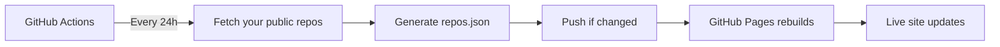

# 🚀 Malik's Portfolio

<div align="center">


**A live 3D portfolio that runs on pure data: WebGL shader hero, a story you can read, and every repo on GitHub feeding the page. No backend. No build step. No ads. No bullshit.**

[](https://github.ragilmalik.com)
[](https://ragilmalik.github.io)
[](https://github.com/features/actions)


</div>

---

## Why this one is different

Most portfolios are a photo, a paragraph, and a "hire me" button. This one is a working demo of the kind of thing I build: a page that makes heavy tech feel light, that pulls real data from GitHub, and that works offline after the first visit.

**The short version:**

- ⚡ **A 3D hero that is not a gimmick** — a WebGL shader scene that runs at 60fps, pauses on request, and falls back gracefully on old phones.
- 📖 **A story section driven by data** — the journey chapters are written by hand in `story.json`, but every date, repo name, and count comes from your real GitHub history.
- 🔄 **Daily auto-sync** — a GitHub Actions workflow fetches your public repos every day and rebuilds `repos.json`. Push code, and the portfolio updates itself.
- 📱 **Installable and offline** — a service worker pre-caches the app shell. It works on a train with no signal.
- 🔍 **Search everything** — press `Ctrl+K` (or `?K`) to jump to any section or any of your repos.

---

## What's inside

| Piece | What it does |
|-------|--------------|
| **Hero** | Your name, headline, roles, and live GitHub counts. Accent color is switchable (key `T`). |
| **Journey** | A timeline of your GitHub history, told as chapters. Dates are real; the writing is yours. |
| **Featured work** | Cards for up to 4 repos, horizontally pinned-scrolled on desktop. Each opens a case study with the live README. |
| **Services** | Four things I build: AI apps, bots/automation, web tools on Cloudflare, Windows desktop apps. Each backed by real repo proof. |
| **Repository index** | Every public repo, newest first. Search, filter by origin (Original/Forks) and language. |
| **Languages** | Language counts from GitHub's primary-language labels, per-year bars, and a cumulative growth chart. |
| **Why me + Contact** | The honest pitch, and a big mailto button. |

All copy lives in `story.json`. You never need to edit `index.html` to change what the page says.

---

## Quick start — make it yours

### Prerequisites

- A GitHub account
- At least one public repository
- About 10 minutes

### Step 1: Fork & rename

1. **Fork this repository.**
2. Open **Settings → Repository name** and set it to `{your-username}.github.io`.
3. Click **Rename**.

### Step 2: Flip on the auto-sync

1. Open the **Actions** tab and enable workflows.
2. Go to **Settings → Actions → General → Workflow permissions** and select **Read and write permissions**.
3. Save, then open the **Actions** tab, pick **Sync GitHub Repositories**, and click **Run workflow**.
4. Wait about 30 seconds. A `repos.json` will appear with your data.

### Step 3: Publish

1. Open **Settings → Pages**.
2. Set source to **Deploy from a branch**, branch `main`, folder `/ (root)`.
3. Save and wait 2–3 minutes. Your site is live at `https://{your-username}.github.io`.

### Step 4: Make it say your name

Edit `story.json`:

- `title`, `summary`, `roles` — the hero copy.
- `chapters` — your journey, one entry per milestone.
- `services` — what you offer.
- `caseStudies` — the long-form “story behind the project” for featured repos.
- `closing` — the contact section.

That's it. Everything else updates itself.

---

## How the auto-sync works



### What updates automatically

| Data | Source | Frequency |
|------|--------|-----------|
| Profile & stats | GitHub API | Daily |
| Repository cards | GitHub API | Daily |
| Stars, forks, watchers | GitHub API | Daily |
| Languages & percentages | Primary-language labels | Daily |
| Timeline & growth chart | Repo creation dates | Daily |
| Skills/topics | Repo topics | Daily |

Manual refresh any time: **Actions → Sync GitHub Repositories → Run workflow**.

---

## Customizing

### Accent color

The theme cycles through cyan, lime, violet, and mono. Press `T` on the site, or edit the `--accent` variable in `assets/app.css`.

### 3D performance

The scene auto-detects reduced motion and weak GPUs. If you want it even lighter, append `?no3d=1` to the URL — the page runs with a static gradient instead.

### Sync schedule

Open `.github/workflows/sync-repos.yml` and change the cron:

```yaml
schedule:
  - cron: '0 0 * * *'   # daily at midnight UTC (default)
  # - cron: '0 */6 * * *'  # every 6 hours
  # - cron: '0 9 * * 1'    # every Monday 9am
```

### Custom domain

Already done here, but in general:

1. Buy a domain and add a CNAME record pointing at `{your-username}.github.io`.
2. Add a `CNAME` file in the repo root containing your domain.
3. Set it under **Settings → Pages → Custom domain**.

This repo uses `github.ragilmalik.com`, and `ragilmalik.github.io` keeps working alongside it.

---

## The files

| File | Purpose |
|------|---------|
| `index.html` | The single page shell. |
| `assets/app.js` | Rendering, 3D scene, palette, case-study panels. |
| `assets/app.css` | All styling, print styles included. |
| `story.json` | Your copy: hero, chapters, services, case studies. |
| `repos.json` | Live GitHub data, generated by the workflow. |
| `sw.js` | Service worker: offline shell, network-first for data. |
| `manifest.webmanifest` | PWA manifest. |
| `404.html` | Styled 404. |
| `.github/workflows/sync-repos.yml` | The daily data sync. |

---

## Troubleshooting

<details>
<summary><strong>My repos are not showing</strong></summary>

1. Check that `repos.json` exists in the repo root.
2. Open **Actions** and confirm the workflow ran green.
3. If it failed, check **Settings → Actions → General → Workflow permissions** → **Read and write**.
4. Run the workflow manually once.

</details>

<details>
<summary><strong>The workflow runs but nothing changes</strong></summary>

The workflow only commits when data actually changed. If `repos.json` is identical, there is nothing to push. That's expected.

</details>

<details>
<summary><strong>Stats show 0 or stale numbers</strong></summary>

1. Run the workflow manually: **Actions → Sync GitHub Repositories → Run workflow**.
2. Hard-refresh the site (`Ctrl+Shift+R`).
3. Check `repos.json` has a fresh `lastUpdated` timestamp.

</details>

<details>
<summary><strong>3D scene is slow or missing</strong></summary>

1. The site already falls back to a gradient when WebGL is unavailable or reduced motion is on.
2. Force the fallback with `?no3d=1`.
3. Update your graphics drivers.

</details>

<details>
<summary><strong>Custom domain shows 404</strong></summary>

1. Confirm the DNS record points at `{your-username}.github.io` and is not proxied (for GitHub Pages, keep the orange cloud off).
2. Set the custom domain under **Settings → Pages**.
3. Wait up to an hour for the certificate to issue, then enable **Enforce HTTPS**.

</details>

---

## Tech stack

| Technology | What it does |
|------------|--------------|
| **Vanilla JS + ES modules** | No framework, no dependency bloat. |
| **WebGL shaders** | The hero background, drawn directly on the GPU. |
| **GitHub REST API** | Data source for everything live. |
| **GitHub Actions** | The daily sync. |
| **Service Worker API** | Offline caching. |
| **CSS Grid / Flexbox / custom properties** | Layout and theming. |

---

## Contributing

Found a bug? Have an idea? Open an issue or a pull request. Keep it simple:

1. Fork the repo.
2. Create a branch (`git checkout -b feature/your-idea`).
3. Commit and push.
4. Open a pull request.

---

## License

This is my personal portfolio. You're welcome to read the code, learn from it, and borrow ideas for your own site. If you want to reuse it wholesale, drop me a message first.

---

<div align="center">

**Built by Malik, for Malik. Powered by GitHub Pages, GitHub Actions, and a lot of coffee.**

[](https://github.com/ragilmalik/ragilmalik.github.io)

</div>
